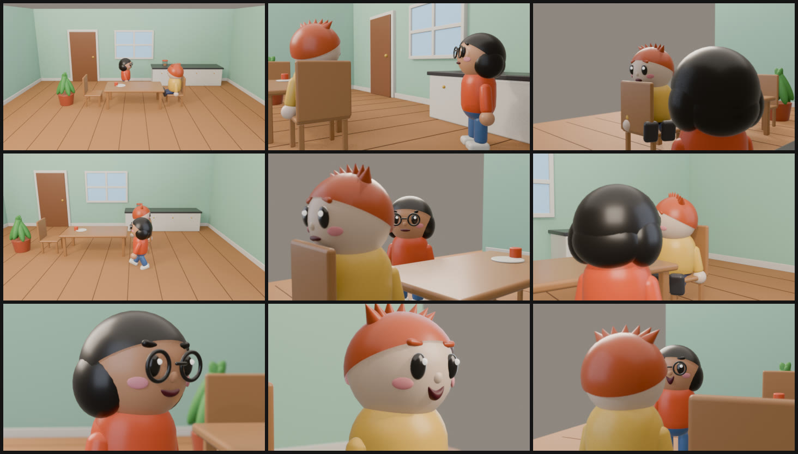
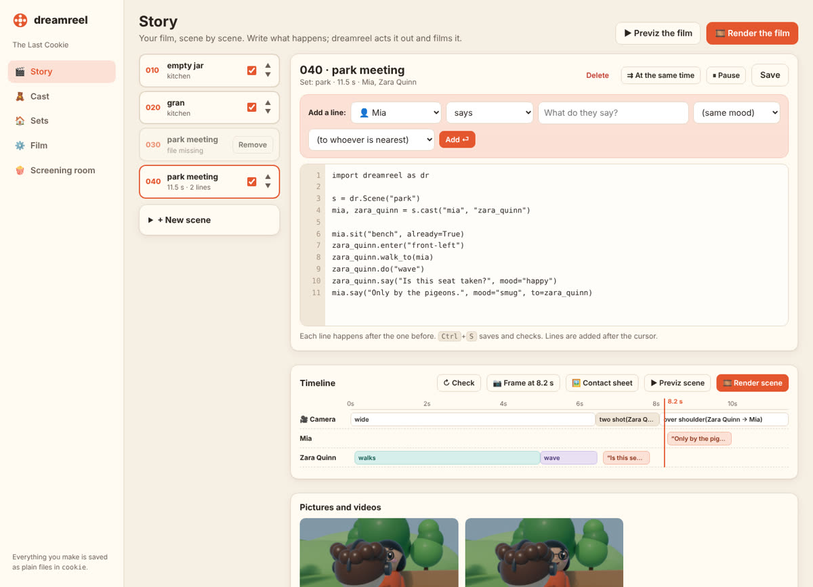
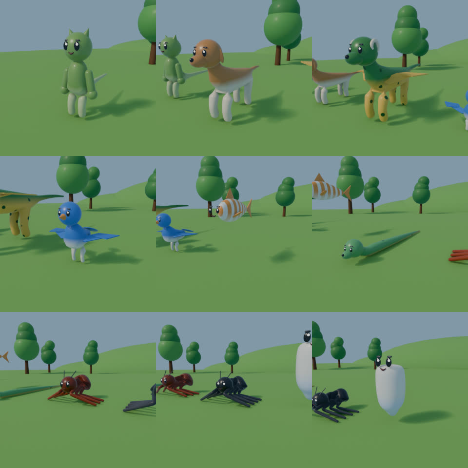
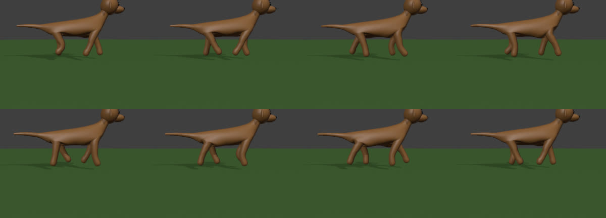
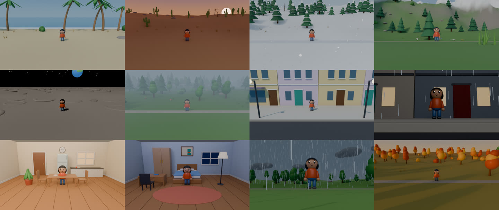
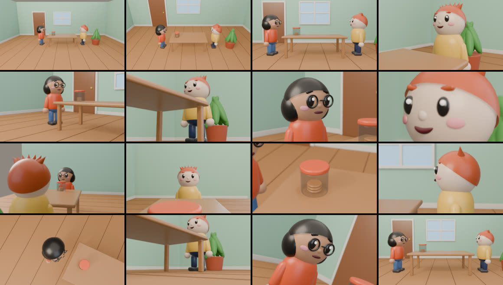
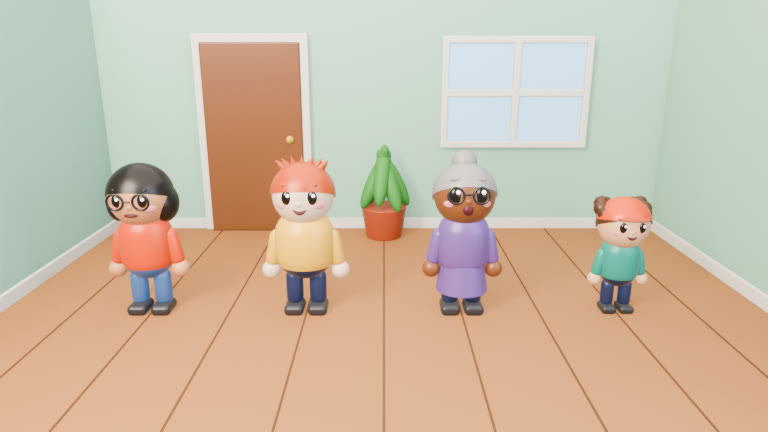
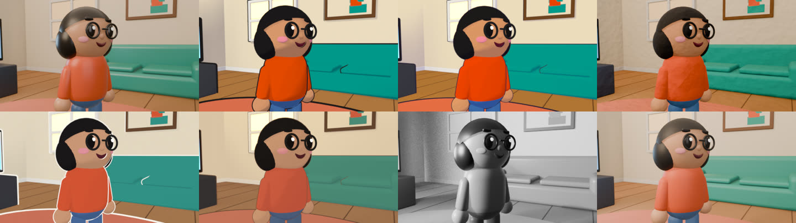

# dreamreel

**Your dream animated film, made easy.** Write what happens; dreamreel builds the characters, the
sets, the acting and the camera work in Blender, and renders the film. No animation skills, no
Blender knowledge, no keyframes.



```python
import dreamreel as dr

s = dr.Scene("kitchen")
mia, tom = s.cast("mia", "tom")

tom.sit("chair-2", already=True)
mia.enter("door").walk_to("counter")
mia.feel("surprised")
mia.turn_to(tom)
mia.say("Tom. The cookie jar is empty.", mood="worried", to=tom)
tom.say("Is it? How strange.", mood="worried", to=mia)
tom.do("shrug")
```

That's a scene, written in Python. In a project the same scene is a list of beats in
`scenes/010_jar.toml`, which dreamreel studio edits with menus. Mia walks in through the door and round the table, her face changes, she talks
with her mouth in sync with her voice, Tom answers, and the camera covers it like a TV director
would: a wide shot while people move, then over-the-shoulder shots and close-ups for the dialogue,
always on the same side of the conversation.

## Why not AI video generation?

| AI video generators | dreamreel |
|---|---|
| Characters change from shot to shot | The same character file in every shot, forever |
| Every change means generating again (and paying again) | Change one line, re-render that scene, for free |
| A few seconds per clip, wobbly motion | Any length; real camera; physically consistent |
| You get pixels | You get a plain-text project: edit it, version it, re-render it in 4K |
| Tokens are spent on pixels | An AI model only writes text (the script); rendering runs on your machine |

dreamreel is designed to be driven by a frontier AI model: you describe the film, the model writes
the project files, `dreamreel check` tells it what happens when (without rendering), and
`dreamreel contact` renders a sheet of frames it can look at. See [docs/ai-director.md](docs/ai-director.md).

## Install

```bash
pip install dreamreel            # includes Blender itself (as the bpy module); no separate install
pip install "dreamreel[voices]"  # optional: free offline voices (Piper)
```

Needs Python 3.13 (what Blender 5.2's `bpy` is built for). A GPU makes final renders much faster
but isn't required.

## dreamreel studio: no code needed

```bash
dreamreel studio        # opens in your browser
```

A friendly app for the whole process. Design characters with a live drawing, lay out sets on a
floor plan, write scenes by picking *who* does *what* from menus, and see every scene as a
timeline. Click any moment to render that frame, then make a quick previz or the final film.
Everything it makes is the same plain-text project, so you can switch between the studio, the
command line and an AI agent at any time.



## Make a film from the command line

```bash
dreamreel new my-film --example   # a finished 50-second short to learn from
cd my-film
dreamreel cast                    # picture of the cast
dreamreel plan kitchen            # map of the set with its marks
dreamreel check                   # every scene's timeline, in a second
dreamreel contact 010             # 6-9 frames of scene 010 on one sheet
dreamreel previz                  # fast flat-shaded film with voices and subtitles
dreamreel render                  # the final film (only changed scenes re-render)
```

A project is a folder of plain text:

```
my-film/
  film.toml              title, frame rate, resolution, scene order, music
  cast/mia.toml          how each character looks and sounds
  sets/kitchen.toml      each place: room or outdoor, furniture, marks
  scenes/010_jar.toml    each scene: the set, the cast and the beats (who does what, in order)
  extensions/*.py        this film's own features, as classes
  audio/                 your music; generated voices are cached here
  renders/               everything dreamreel renders
```

## Any body, any creature

Characters are either jointed toy figures or **creatures** built from a body plan: biped,
quadruped, bird, fish, serpent, bug, spider, frog or blob. Proportions, heads, ears, horns, wings,
patterns and colours come from a few settings. Creatures walk, trot, gallop, scuttle, swim,
slither, hop and fly, with feet that stay planted on the ground. Every one of them talks and shows
moods with the same face system: brows, lids, irises that shrink in terror, teeth gritted in fury,
grins, sneers, blushes, tears and sweat, from a gentle smile to a crazed grin.




## Any place, any light, any weather

Rooms furnish themselves (living room, kitchen, bedroom, office, classroom, café, science lab),
with ceilings and strip lights when the camera looks up. Outdoors, a
biome lays out the land and what grows on it by rules: meadow, forest, autumn woods, beach, desert,
snow, mountains or the moon. A whole town street (buildings, shops, pavements, lamps, parked cars)
comes from one line. Every scene picks its time of day (dawn to night) and weather (clouds,
overcast, fog, rain, snow, storms with lightning, wind in the trees).



## Acting, not just moving

Movement follows the classic principles of animation: gestures anticipate and follow through, jumps
squash and stretch, long hair and floppy ears swing and settle. Every gesture and walk is shaped by
the character's mood or by a manner you give it (`how = "nervously"`), using the four Laban effort
qualities (weight, time, space, flow), so an angry wave and a sad wave are different performances.
Characters pick things up, carry them, hand them over and put them down, and can grab small
creatures. They throw and catch, knock things over and kick balls, and those things fall, bounce,
roll and tumble with real physics. Add motion-capture clips (BVH or FBX) to a film's `motions/` folder and any character can
perform them: dances, cartwheels, fights, retargeted to their body; walks use library walk cycles.
See [docs/acting.md](docs/acting.md).

## Your own characters

Bring a 3D model (glTF/GLB, FBX or OBJ) into a film's `models/` folder and cast it with
`type = "model"`. Rigged models (Mixamo, Ready Player Me, VRoid...) keep their skeleton, whatever its
bones are called; unrigged models in a T or A pose get one automatically, found from the shape of the
body. Either way the model walks, gestures, performs motion capture, carries things and, if it has
facial shape keys, smiles, frowns and blinks with the story's moods.

## A real camera

Shots combine framing (establishing to extreme close-up, two-shot, over-the-shoulder, point of view,
insert, group) × angle (eye level, high, low, overhead, worm's eye) × side × Dutch tilt × lens ×
camera move (push in, pull out, pan, tilt, truck, crane, orbit, follow, zoom, dolly zoom, focus pull,
handheld). Headroom, lead room and the 180° rule are handled for you, and the camera moves out of
the way of furniture. Without any shots, an automatic director covers the scene and picks angles
and moves from the mood of each moment.



## Editing like an editor

Scenes join with cuts, fades, dissolves, wipes, irises, clock wipes, pushes, whip pans, zooms or
flashes, set per scene or in the film's edit list. The edit list also does cross-cutting (play part
of a scene, cut away, come back), J and L cuts and split screens. Inside a scene, slow motion (with
speed ramps), freeze frames and jump cuts retime the animation itself, so slow motion is smooth,
and screen effects fade, flash or dip the picture. Changing the edit never re-renders a scene.

## Everything is extensible

Every feature is a Python class: character types, body plans, hair, extras, moods, gestures,
actions, props, set kinds, biomes, scenery, times of day, weather, visual styles, camera shots and moves, transitions,
screen effects and voice engines. A film can add its own in its
`extensions/` folder (`dreamreel extend prop campfire` starts one). New classes immediately work
in cast, set and scene files and show up in the studio's menus. When a film needs something
dreamreel doesn't have, you or your AI agent add it as a class instead of working around it.

## The look



The characters are **toy figures**: jointed vinyl characters with big heads and stubby limbs, a
style where procedural animation looks intentional instead of stiff. One line in `film.toml`
(`style = "toon"`) changes the look of the whole film, and a scene can have its own (a noir
flashback, a storybook dream): toy, toon, anime, clay (animated on twos, like stop-motion), paper
cut-out (on threes), storybook, noir and realistic. Styles change materials, outlines, light and
colour, never the staging, so trying one costs a re-render and nothing else.



## Docs

- [Getting started](docs/getting-started.md)
- [dreamreel studio](docs/studio.md)
- [Reference](dreamreel/templates/REFERENCE.md): cast, sets, actions, moods, gestures, camera
- [Working with an AI model](docs/ai-director.md)
- [Roadmap](ROADMAP.md)

## Licence

MIT. Blender (bpy) is GPL; Piper voices have their own licences (see each voice's model card).
