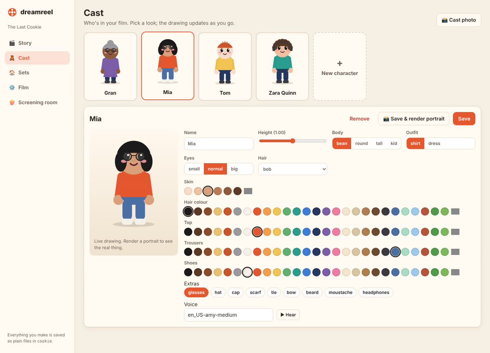

# dreamreel studio

```bash
dreamreel studio              # in a film folder, or in a folder where you keep films
dreamreel studio my-film      # open a specific film
dreamreel studio --port 9000 --no-browser
```

The studio opens in your browser at `http://127.0.0.1:8765`. It runs on your computer only. Nothing
is uploaded anywhere.



## The rooms

| | |
|---|---|
| **Story** | Your scenes in order. Tick a scene to put it in the film; use the arrows to reorder. Each scene has a line builder, the script, a timeline and its pictures. |
| **Cast** | Your characters. Choose body, skin, hair, clothes and extras; the drawing updates as you click. **Save & render portrait** shows the real 3D character. **Voice**: pick the language, then a ready-made voice, a voice described in words, a copy of a real voice (record it right there with the microphone), or a Fish Audio voice; **Hear them** plays it. **Make one with AI** makes a new character or prop from a description (any AI model, free local ones too) or from a picture (on a booster). |
| **Sets** | Your places. Room or outdoors, wall colour, floor, and furniture on a floor plan seen from above, with the camera at the bottom. **Picture** renders the empty set; **Map** shows every spot by name. |
| **Film** | Title, picture size (including vertical for phones), frame rate, music, lip sync. Previz or render the whole film. |
| **Toolbox** | Everything the film can use, plus: the **Booster** (graphics-card AI on a free Colab notebook: open it, paste its address and key), **Voices and languages** (which engines speak which language), **Direct with an AI assistant** (the lines to connect Claude or any MCP app), and **Keys for AI services** (saved on your computer, never in the film). |
| **Screening room** | Every film and scene you've rendered, ready to watch or download. |

## Writing a scene

1. **New scene**: say what happens, pick the set and who's in it.
2. **Add a line**: pick who (or *The scene* for pauses, captions and camera shots), what they do,
   and the details, then press **Add**. The line goes in after the cursor.
3. The scene is saved and checked after every line. The **timeline** shows the camera shots and
   each character's walking, talking and gestures, and the scene's length.
4. Click anywhere on the timeline, then **Frame at…** to render that moment. **Contact sheet**
   renders six moments at once.
5. Select some lines and press **At the same time** to make them happen together.
   **Pause** adds a one-second wait.

The script is real dreamreel code, so you can type in it directly too. **Ctrl+S** saves and checks.
If something is wrong, a red note says which line and why, and **Show me** jumps to it.

## Rendering

Renders run one at a time in the background; progress shows in the bottom-right corner, and
**Stop** cancels. Checks are quick and run straight away. Final renders are slow without a graphics
card: render one frame or a contact sheet to check a look before rendering a whole scene.

## Good to know

- The studio writes the same files as the command line and an AI agent. Use whichever you like and
  switch any time.
- Saving a character, set or film settings from the studio rewrites that `.toml` file and drops
  any comments in it. Scene scripts are saved exactly as written.
- Voices need Piper: `pip install "dreamreel[voices]"`. Write a line in an Indian script and it's
  spoken in that language.
- A scene's header has **Repaint the final render with AI** (experimental, needs a booster).
